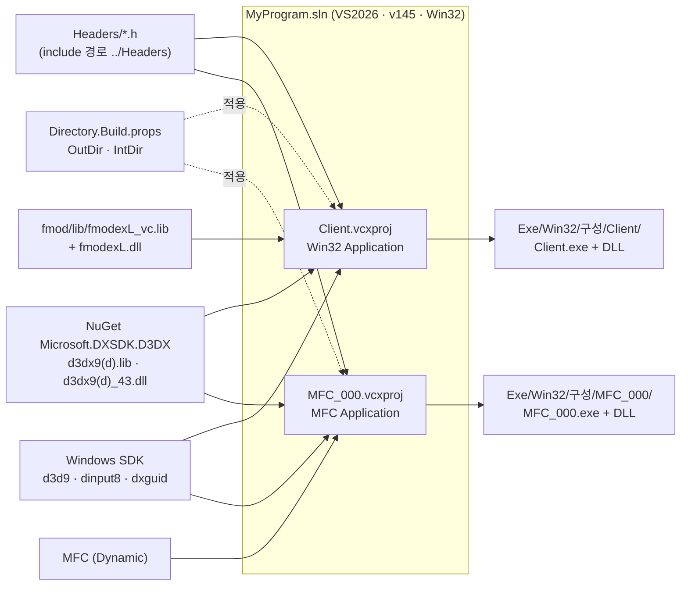
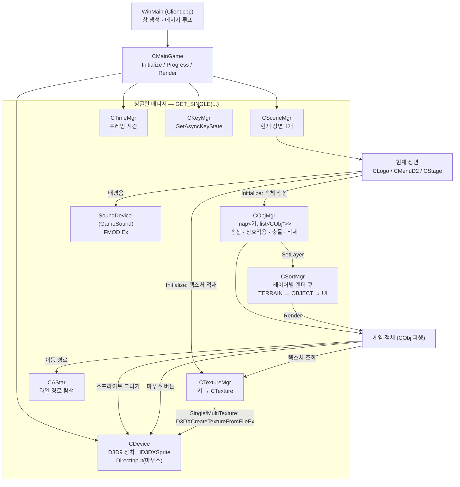
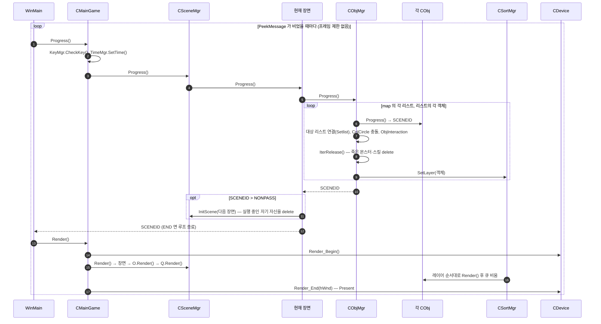
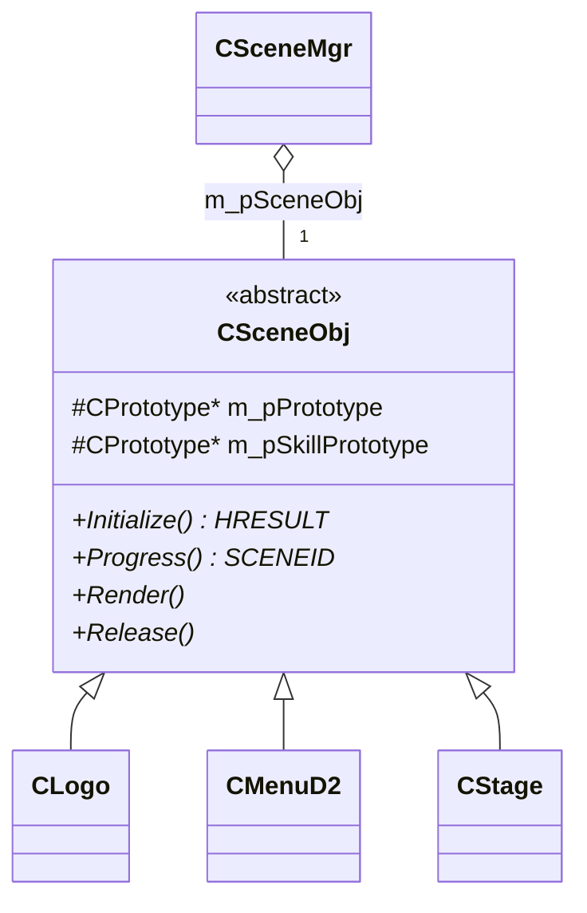
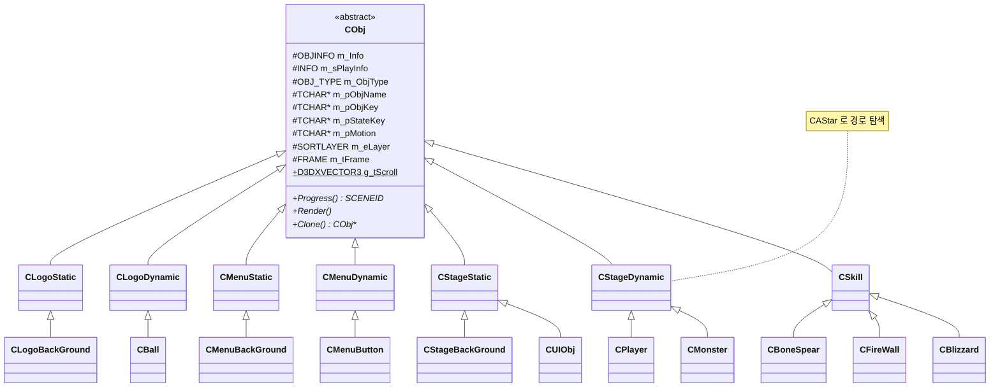
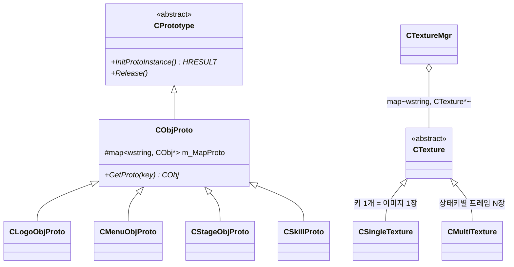
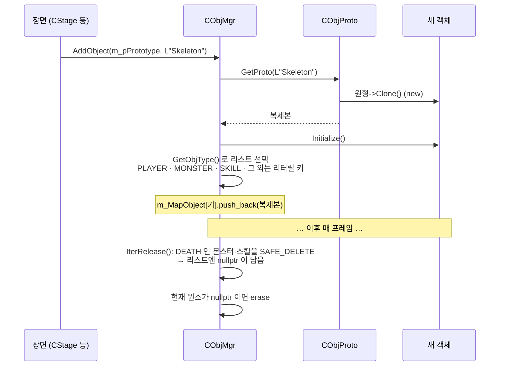
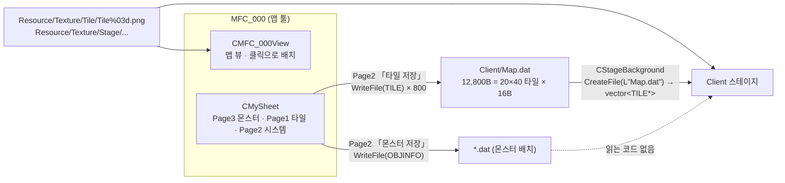
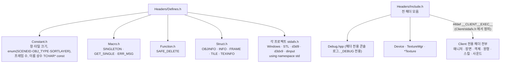

# 2D-Portfolio 아키텍처

DirectX 9 기반 2D 아이소메트릭 액션 RPG(2016)와 맵 편집 툴. 이 문서는 **현재 코드가 실제로 어떻게 생겼는지**를 기록한다
(2026-11-10, `master` 기준). 고칠 점은 [legacy-audit/review.md](../intent/legacy-audit/review.md), 작업 규칙은 [CLAUDE.md](../CLAUDE.md).

다이어그램은 Mermaid — GitHub·VS Code 에서 그림으로 보인다.

## 1. 저장소 구조

```
Portfolio/
├── AGENTS.md · CLAUDE.md          # 에이전트 협업 규칙 / 이 repo 관례
├── .harness/ · .claude/ · .hermes/ # agent-harness (SDLC 템플릿·스킬)
├── intent/<슬러그>/                # 변경별 intent · spec · plan (SSOT)
├── docs/ARCHITECTURE.md            # 이 문서
└── 2D-Portfolio/
    ├── MyProgram.sln               # 솔루션: Client, MFC_000 + 솔루션 폴더 Headers
    ├── Directory.Build.props       # 모든 프로젝트의 OutDir / IntDir
    ├── Headers/                    # 두 프로젝트 공용 헤더 (Constant · Struct · Macro · Function · Include · Debug.hpp)
    ├── Client/                     # 게임 (Win32 앱, ~100 파일)
    │   ├── *.cpp/*.h               # 클래스 1개 = 파일 1쌍, 평평한 구조
    │   ├── fmod/                   # FMOD Ex 헤더·import lib
    │   ├── Map.dat                 # 툴이 만든 타일 맵 (게임이 읽음)
    │   └── *.mp3                   # 배경음
    ├── MFC_000/                    # 맵·몬스터 배치 툴 (MFC 앱)
    ├── Resource/Texture/           # 텍스처 8,220 파일 (76MB)
    ├── packages/                   # NuGet 복원 (gitignore)
    ├── Exe/<플랫폼>/<구성>/<프로젝트>/   # 빌드 산출물 (gitignore)
    └── Temp/<플랫폼>/<프로젝트>/<구성>/  # 중간 파일 (gitignore)
```

## 2. 빌드 구성



- Client 의 런타임 DLL 은 Post-Build 가 `Exe/.../Client/` 로 복사, D3DX DLL 은 NuGet 타깃이 복사한다.
- 실행 시 **작업 디렉터리는 `2D-Portfolio/Client/`(툴은 `MFC_000/`)** 여야 한다 — 리소스 경로가 `../Resource/...` 상대 경로.

## 3. 런타임 구성 (Client)

계층이 아니라 **싱글턴 매니저들을 중심으로 한 별(star) 구조**다. 매니저는 `SINGLETON(type)` 매크로(`Headers/Macro.h`)로
만들고 어디서든 `GET_SINGLE(type)` 으로 접근한다.



## 4. 한 프레임의 흐름



- 장면 전환은 **객체의 `Progress()` 반환값**이 위로 전달돼 일어난다. 장면이 자기 `Progress()` 안에서 `InitScene` 을 불러
  자신을 지우는 구조라, 그 뒤에 멤버를 건드리면 use-after-free 다(오딧 3번).
- `CSortMgr` 는 레이어 순서만 보장한다. 같은 레이어 안의 앞뒤(Y 정렬)는 `ObjMgr` 순회 순서를 따른다.

## 5. 장면 전환

```mermaid
stateDiagram-v2
    [*] --> Logo: CMainGame::Initialize<br/>InitScene(SCENEID_LOGO)
    Logo --> Menu: CBall::Progress<br/>return SCENEID_MENU (Ball.cpp:41)
    Menu --> Stage: CMenuButton 「시작」<br/>SCENEID_STAGE (MenuButton.cpp:51)
    Menu --> [*]: CMenuButton 「종료」<br/>SCENEID_END (MenuButton.cpp:59)
    Stage --> [*]: 창 닫기 (WM_QUIT)
```

| 장면 | 클래스 | 원형 객체(Prototype) | 배경음 |
|---|---|---|---|
| 로고 | `CLogo` | `CLogoObjProto` — 배경, `CBall` | — |
| 메뉴 | `CMenuD2` | `CMenuObjProto` — 배경, 시작/종료 버튼 | `Wilderness.mp3` |
| 스테이지 | `CStage` | `CStageObjProto` — 배경(타일) 1, UI 20종, 플레이어·동료 3, 몬스터 8종 | `Tristram.mp3` |

`CStage::Initialize` 가 텍스처 수백 장(`../Resource/Texture/...`)과 객체를 한 번에 적재한다. `CStage::Release` 는
`CTextureMgr`·`CObjMgr` 싱글턴을 통째로 파괴한다.

## 6. 클래스 구조

### 6.1 장면



### 6.2 게임 객체

모든 객체는 같은 수명주기 `Initialize → Progress → Render → Release` 와 `Clone()` 을 가진다.



### 6.3 원형(Prototype)과 텍스처



`CPlayer` 는 자기 스킬용 `CSkillProto` 를 따로 가진다(`Player.cpp:24`).

## 7. 객체 생성과 소멸



- 원형(`m_MapProto`)은 장면이 소유하고 장면 `Release` 때 지워진다. 게임 객체는 `CObjMgr` 가 소유한다.
- 객체 사이 참조(`m_pTagetObj`, `Setlist` 로 넘기는 리스트 포인터)는 소유권 없이 날 포인터다.
- `nullptr` 잔류와 그 위험은 오딧 1번.

## 8. 데이터 흐름 — 툴 → 게임



- 파일 포맷 = 구조체를 그대로 덤프한 것. `TILE`(`Headers/Struct.h:216`)·`OBJINFO`(`Struct.h:12`)를 바꾸면 기존 `.dat` 와 호환이 깨진다.
  두 구조체 모두 포인터가 없어 x86·x64 간에는 호환된다.
- 몬스터 배치 데이터는 툴이 저장만 하고 게임은 읽지 않는다 — 몬스터는 `CStage` 코드가 직접 생성한다.

## 9. MFC 툴 화면 구성

```
┌───────────────── CMainFrame ─────────────────────────────┐
│ m_MainSplitte (1행 × 2열)                                  │
│ ┌──────────────┐ ┌─────────────────────────────────────┐ │
│ │ CMiniView    │ │                                     │ │
│ │ (미니맵)      │ │  CMFC_000View  (CScrollView)        │ │
│ ├──────────────┤ │  맵 전체 렌더 · 클릭 배치            │ │
│ │ CMyForm      │ │  OnLButtonDown / OnLButtonDblClk    │ │
│ │  └ CMySheet  │ │                                     │ │
│ │   ├ Page3 몬스터│ │                                     │ │
│ │   ├ Page1 타일 │ │                                     │ │
│ │   └ Page2 시스템│ │                                     │ │
│ └──────────────┘ └─────────────────────────────────────┘ │
└──────────────────────────────────────────────────────────┘
```
`MainFrm.cpp:319-330` 이 스플리터를 만들고, `MySheet.cpp:27-29` 가 페이지를 붙인다.
툴은 Client 와 같은 이름의 `CDevice`·`CTextureMgr`·`C*Texture` 를 **별도 사본**으로 가진다(내용이 갈라짐, 오딧 9번).

## 10. 공용 헤더



대부분의 `.cpp` 가 `Include.h` 하나로 모든 헤더를 끌어온다 — 헤더 하나만 바뀌어도 거의 전체가 다시 컴파일된다.

## 11. 구조상 알려진 문제 (요약)

자세한 근거·우선순위는 [오딧](../intent/legacy-audit/review.md).

| 영역 | 문제 | 오딧 |
|---|---|---|
| 객체 수명 | `IterRelease` 가 nullptr 을 리스트에 남김, `erase` 후 원소 건너뜀 | 1, 3 |
| 식별 | 이름·상태를 `TCHAR*` **주소**로 비교 — `/GF` 문자열 병합에 기대 동작 | 2 |
| 장면 전환 | 장면이 자기 `Progress()` 안에서 자신을 delete | 3 |
| 결합도 | 모든 것이 전역 싱글턴 + `Include.h` 일괄 include | — |
| 중복 | 렌더링 계층(Device·Texture) 5쌍이 Client·툴에 따로 | 9 |
| 입력 | DirectInput(마우스) + `GetAsyncKeyState`(키보드) 혼용 | 10 |

## 12. 구현되지 않은 기능

[dead-code-removal](../intent/dead-code-removal/plan.md)(2026-11-11)에서 실행되지 않는 코드를 지우며 남긴 의도. 코드는 git 이력에 있다
(`git log --grep dead-code-removal`).

| 기능 | 남아 있던 흔적 | 지운 커밋 종류 |
|---|---|---|
| 2·3 스테이지 | `CStage2`(배경음 `Cave.mp3`, 몬스터 Viper 10마리 유지), `CStage3`(SandRaider). 진입 경로(`SCENEID_STAGE2/3` 반환)가 없었고 `Initialize` 가 비어 있어 도달하면 크래시했다. `Resource/` 의 해당 리소스는 남아 있다 | 도달 불가 장면 |
| 보스 | 2 스테이지 Izual·Andariel, 3 스테이지 Diablo 소환(주석, 「아직 몬스터 텍스쳐 추가 코드가 없음」). 이름 상수와 `ObjMgr.cpp` 의 보스 판정은 남아 있다 | 도달 불가 장면 |
| 키보드 이동 | `CPlayer::CheckKey` 의 DirectInput 방향키 이동(주석). 지금 이동은 마우스 클릭뿐 | 주석 처리된 코드 |
| 전체화면 전환 | `WndProc` 의 `WM_CHAR` → `ModeSetter` 로 창/전체화면 토글(주석), `CMainGame::Initialize` 의 Release 전체화면 분기(주석). `CFullModeMgr` 자체는 시작 창 설정에 쓰인다 | 주석 처리된 코드 |
| NPC·건물 | `CObjMgr::AddObject` 의 `OBJ_NONPLAYER`·`OBJ_BROKENBUILDING`·`OBJ_BUILDING` 분기(주석), 빈 클래스 `CNonPlayer`. `OBJ_TYPE` enum 값은 남아 있다 | 주석 처리된 코드, 미사용 클래스 |
| 스킬 객체 미리 생성 | `CStage::Initialize` 의 스킬 6종(BoneSpear·FireWall·Blizzard·Heal·Aura·Rivive) `AddObject` 블록(주석). 지금 스킬은 시전할 때 만든다 | 주석 처리된 코드 |
| 아이템 | `ITEM_*` 비트 플래그(주석), `ItemInfoRect` UI 원형(주석) | 주석 처리된 코드 |
| 툴 플레이어 페이지 | `CPage4`(캡션 「Player」, 슬라이더·그림 컨트롤 대화상자) — 시트에 붙지 않았다 | 툴 Page4 |
